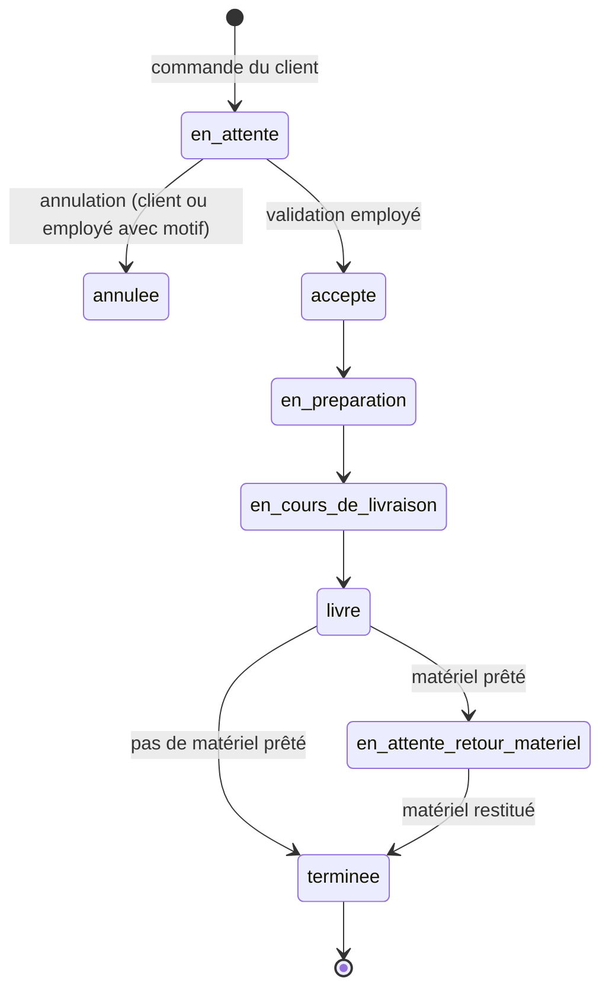
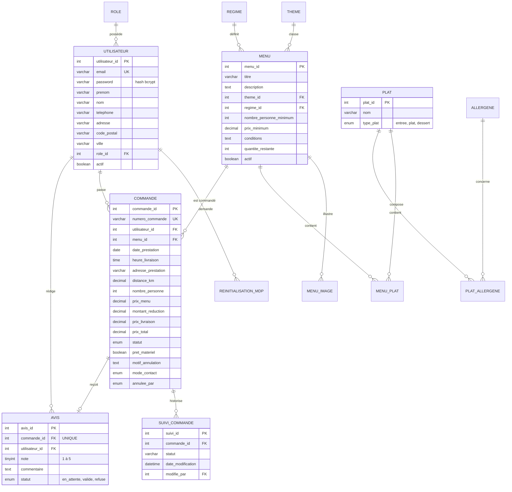

# Vite & Gourmand — Dossier de conception

## 1. Analyse des besoins

### Acteurs

| Acteur | Description | Création du compte |
|---|---|---|
| Visiteur | Personne non connectée | — |
| Utilisateur | Client inscrit, peut commander | Inscription libre sur le site |
| Employé | Membre de l'équipe (Julie) | Créé par l'administrateur |
| Administrateur | Gérant (José), fait tout ce que fait un employé + gestion des employés et statistiques | Uniquement par script SQL (jamais depuis l'application) |

### Fonctionnalités par acteur

**Visiteur**
- Consulter l'accueil (présentation, professionnalisme, avis validés)
- Consulter la vue globale des menus avec filtres dynamiques (sans rechargement)
- Consulter le détail d'un menu (conditions mises en évidence)
- Créer un compte, se connecter, réinitialiser son mot de passe
- Envoyer une demande via le formulaire de contact
- Consulter les mentions légales et les CGV

**Utilisateur** (en plus du visiteur)
- Commander un menu (formulaire pré-rempli, calcul du prix en direct)
- Consulter ses commandes et leur suivi
- Modifier ou annuler une commande tant qu'elle est « en attente »
- Modifier ses informations personnelles
- Déposer un avis (note 1 à 5 + commentaire) sur une commande terminée

**Employé**
- Gérer les menus, plats et horaires (CRUD)
- Filtrer les commandes (par statut, par client)
- Faire évoluer le statut des commandes
- Annuler une commande, avec motif et mode de contact obligatoires
- Valider ou refuser les avis

**Administrateur** (en plus de l'employé)
- Créer un compte employé (le mot de passe n'est pas envoyé par mail)
- Désactiver un compte employé
- Visualiser le nombre de commandes par menu sous forme de graphique (données MongoDB)
- Calculer le chiffre d'affaires par menu, filtrable par menu et par période

## 2. Règles de gestion

| # | Règle |
|---|---|
| RG1 | Un mot de passe contient au minimum 10 caractères, dont 1 majuscule, 1 minuscule, 1 chiffre et 1 caractère spécial. |
| RG2 | L'email est unique et sert d'identifiant de connexion. |
| RG3 | À l'inscription, le rôle « utilisateur » est attribué automatiquement et un mail de bienvenue est envoyé. |
| RG4 | Aucun compte administrateur ne peut être créé depuis l'application. |
| RG5 | Un compte désactivé ne peut plus se connecter. |
| RG6 | Le nombre de personnes commandé est supérieur ou égal au minimum du menu. |
| RG7 | Prix du menu = prix minimum ÷ nombre minimum × nombre de personnes. |
| RG8 | Réduction de 10 % si nombre de personnes ≥ minimum + 5. |
| RG9 | Livraison gratuite à Bordeaux ; ailleurs 5 € + 0,59 € par kilomètre. |
| RG10 | Les prix sont figés dans la commande au moment de la validation. |
| RG11 | Un client peut annuler ou modifier sa commande (sauf le menu) tant qu'elle est « en attente ». |
| RG12 | Un employé ne peut annuler une commande qu'avec un motif et un mode de contact (téléphone ou mail). Une annulation par le client enregistre aussi un motif. Toute annulation remet le menu en stock. |
| RG13 | Chaque changement de statut est historisé avec sa date et son heure (suivi de commande). |
| RG14 | Au statut « en attente du retour de matériel », le client reçoit un mail : sans restitution sous 10 jours ouvrés, 600 € de frais sont facturés. |
| RG15 | Au statut « terminée », le client reçoit un mail l'invitant à donner son avis. |
| RG16 | Un seul avis par commande, uniquement sur une commande terminée, avec une note de 1 à 5. |
| RG17 | Un avis n'est visible sur l'accueil qu'après validation par un employé. |
| RG18 | Une commande décrémente le stock du menu ; un menu sans stock ne peut plus être commandé. |
| RG19 | Un plat peut appartenir à plusieurs menus ; un plat peut avoir plusieurs allergènes. |

### Cycle de vie d'une commande



## 3. Modèle de données relationnel (MySQL)



Tables de référence non détaillées ci-dessus : `role`, `theme`, `regime`, `allergene`, `menu_image`, `horaire`, `reinitialisation_mdp`, et les tables d'association `menu_plat` et `plat_allergene`.

### Choix de conception justifiés

- **Tables d'association `menu_plat` et `plat_allergene`** : relations N-N exigées par le sujet (un plat dans plusieurs menus, plusieurs allergènes par plat).
- **Thèmes, régimes et rôles en tables séparées** plutôt qu'en ENUM : le client peut en ajouter sans modifier la structure (« vous pouvez alimenter davantage cette catégorie »).
- **Prix figés dans `commande`** : si Julie change le prix d'un menu, les anciennes commandes et le chiffre d'affaires restent justes.
- **Table `suivi_commande`** : répond au besoin d'historique des statuts avec date et heure.
- **Contraintes `CHECK`** : la base refuse elle-même une note hors de 1 à 5, ou une annulation sans motif (et sans mode de contact si c'est un employé qui annule) (défense en profondeur, en plus des contrôles PHP).
- **`ON DELETE CASCADE`** sur les tables dépendantes (images, compositions) ; **pas de cascade** sur `commande → utilisateur` ni sur `commande → menu`, pour ne jamais perdre l'historique comptable.
- **Désactivation (`actif`) plutôt que suppression** d'un employé, pour conserver la traçabilité de ses actions (`suivi_commande.modifie_par`).

## 4. Base non relationnelle (MongoDB)

Le sujet impose une base NoSQL pour les statistiques de l'administrateur.

**Collection `commandes_stats`** : un document est inséré à chaque nouvelle commande, et mis à jour en cas d'annulation.

```json
{
  "commande_id": 1,
  "menu_id": 1,
  "menu_titre": "Réveillon de Noël",
  "date_commande": "2025-12-01T10:15:00Z",
  "nombre_personne": 13,
  "prix_total": 526.50,
  "statut": "terminee"
}
```

**Pourquoi MongoDB ici ?**
- Les données sont dénormalisées (le titre du menu est copié dans le document) : pas de jointure, donc des agrégations rapides pour les graphiques.
- Le pipeline d'agrégation (`$match`, `$group`, `$sum`) calcule directement le nombre de commandes et le chiffre d'affaires par menu, filtré par période.
- Les statistiques sont séparées de la base transactionnelle : les requêtes lourdes de l'administrateur ne ralentissent pas les commandes des clients.

Exemple d'agrégation (chiffre d'affaires par menu sur une période, hors commandes annulées) :

```js
db.commandes_stats.aggregate([
  { $match: {
      statut: { $ne: "annulee" },
      date_commande: { $gte: ISODate("2026-01-01"), $lt: ISODate("2027-01-01") }
  } },
  { $group: {
      _id: "$menu_titre",
      nb_commandes: { $sum: 1 },
      chiffre_affaires: { $sum: "$prix_total" }
  } },
  { $sort: { chiffre_affaires: -1 } }
])
```

## 5. Scripts SQL

| Fichier | Contenu |
|---|---|
| `database/01_schema.sql` | Création de la base, des tables, des contraintes et des index |
| `database/02_data.sql` | Jeu de données de démonstration (comptes, menus, plats, commandes, avis) |

Installation :

```bash
mysql -u root -p < database/01_schema.sql
mysql -u root -p < database/02_data.sql
```

### Comptes de démonstration

| Rôle | Email | Mot de passe |
|---|---|---|
| Administrateur | jose@vite-gourmand.fr | Admin@Vite2026! |
| Employée | julie@vite-gourmand.fr | Employe@Vite2026! |
| Utilisateur | marie.dupont@example.com | Client@Vite2026! |
| Utilisateur | thomas.martin@example.com | Client@Vite2026! |
| Employé désactivé | ancien.employe@vite-gourmand.fr | Employe@Vite2026! (connexion refusée) |
