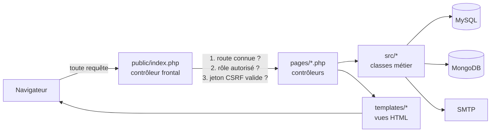
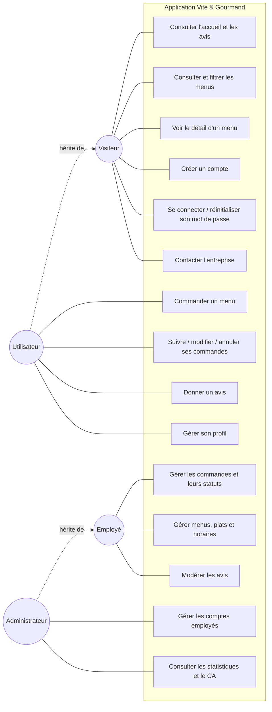
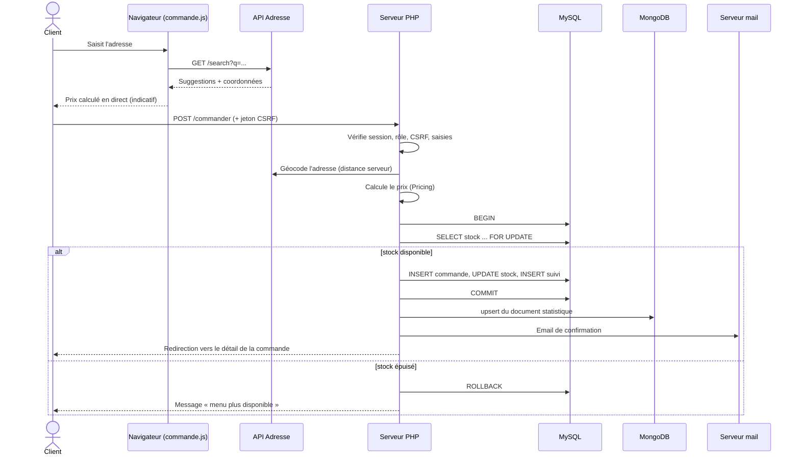
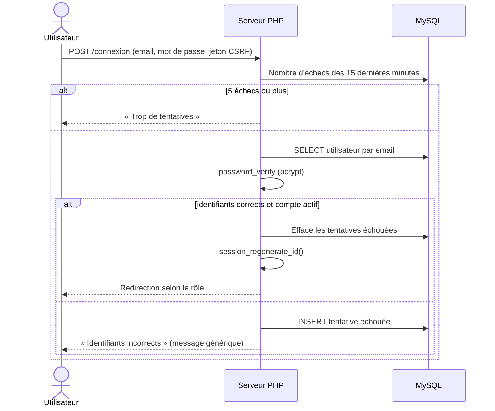

# Vite & Gourmand — Documentation technique

## 1. Réflexions initiales sur les technologies

### Contraintes du sujet

- Une base **relationnelle** et une base **non relationnelle** sont obligatoires.
- L'application doit être **déployée** et **accessible** (RGAA), avec des exigences fortes de **sécurité** et de **RGPD**.
- Le client (Julie et José) n'a aucune compétence technique : le back-office doit être simple, et la maintenance peu coûteuse.

### Choix retenus et alternatives étudiées

| Besoin | Choix | Alternatives étudiées | Justification |
|---|---|---|---|
| Back-end | **PHP 8.3 natif + PDO** | Symfony, Laravel, Node.js/Express | Aucune dépendance lourde, hébergement universel et bon marché. Écrire soi-même le routeur, l'authentification et la protection CSRF prouve qu'on maîtrise ce qu'un framework ferait automatiquement. Pour une application plus grande ou une équipe, **Symfony** serait préférable (sécurité, formulaires, migrations Doctrine prêts à l'emploi), au prix d'une courbe d'apprentissage et d'une dépendance au framework. |
| Accès aux données | **PDO, requêtes préparées** | ORM (Doctrine, Eloquent) | Le sujet évalue la maîtrise du SQL : les requêtes sont écrites à la main, et toujours préparées (protection contre l'injection SQL). Un ORM ferait gagner du temps, mais masquerait le SQL. |
| Base relationnelle | **MySQL 8 / MariaDB** | PostgreSQL | Les données sont fortement liées (menus, plats, allergènes, commandes) : le relationnel garantit l'intégrité (clés étrangères, contraintes, transactions). MySQL est le plus répandu chez les hébergeurs. PostgreSQL aurait aussi convenu. |
| Base NoSQL | **MongoDB** | Redis, Firebase | Les statistiques (commandes et chiffre d'affaires par menu) sont des agrégations : le pipeline d'agrégation de MongoDB les calcule sans jointure, sur des documents dénormalisés. Redis est surtout un cache clé-valeur, peu adapté aux agrégations. |
| Front-end | **HTML5, Bootstrap 5, JavaScript natif** | React, Vue | Site majoritairement composé de pages de contenu et de formulaires : un rendu serveur est plus simple, mieux référencé (SEO) et plus accessible. JavaScript n'est utilisé que là où il apporte un vrai gain (filtres sans rechargement, prix en direct, graphique). Bootstrap assure le responsive et une bonne base d'accessibilité. |
| Graphiques | **Chart.js** | D3.js | Simple, léger, suffisant pour un graphique en barres. |
| Emails | **PHPMailer + SMTP** | fonction `mail()` | `mail()` est peu fiable (souvent classé en spam). PHPMailer gère le SMTP authentifié et chiffré (TLS). |
| Adresses | **API Adresse (data.gouv.fr)** | Google Maps | Gratuite, sans clé, données officielles françaises. Sert à l'autocomplétion de l'adresse et au calcul des frais de livraison. |
| Hébergement | **Fly.io + Docker** | Heroku, Vercel, Azure | Fly.io exécute un conteneur Docker (identique en local et en production), propose une région à Paris et un HTTPS automatique. Vercel n'est pas adapté à PHP. |

## 2. Configuration de l'environnement de travail

| Outil | Usage |
|---|---|
| Visual Studio Code (extensions PHP Intelephense, ESLint) | Éditeur de code |
| Docker Desktop + `docker-compose.yml` | Environnement complet en une commande : PHP/Apache, MySQL, MongoDB, Mailpit |
| Mailpit | Interception des emails en développement (http://localhost:8025) |
| Git + GitHub | Versionnement, avec une branche par fonctionnalité |
| Composer | Dépendances PHP (`mongodb/mongodb`, `phpmailer/phpmailer`) |
| MySQL Workbench / MongoDB Compass | Consultation des bases |
| Figma | Wireframes et maquettes |
| Navigateur + Lighthouse + extension axe DevTools | Tests responsive, performance et accessibilité |

Les secrets (mots de passe, URI de connexion) sont dans un fichier `.env` **non versionné** (présent dans `.gitignore`). Le fichier `.env.example` documente les variables attendues.

## 3. Architecture de l'application

Architecture **MVC légère** avec un **contrôleur frontal** :

- **Modèle** : `src/` (`MenuRepository`, `CommandeService`, `Pricing`, `Stats`...) regroupe le SQL et les règles métier.
- **Vue** : `templates/` ne contient que de l'affichage, et chaque donnée dynamique y est échappée avec `e()`.
- **Contrôleur** : `pages/` lit la requête, appelle le modèle, puis choisit la vue.

Toutes les requêtes passent par `public/index.php`, et seul le dossier `public/` est exposé par le serveur web. Les contrôles de sécurité (rôles, CSRF) sont donc centralisés à un seul endroit, impossible à oublier.

## 4. Modèle de données

Le modèle conceptuel, les règles de gestion et le choix MongoDB sont détaillés dans [01_conception.md](01_conception.md).

## 5. Diagramme de cas d'utilisation

L'utilisateur peut faire tout ce que fait le visiteur ; l'administrateur peut faire tout ce que fait l'employé.

## 6. Diagrammes de séquence

### Passer une commande

### Se connecter

## 7. Sécurité : dispositions prises

| Menace | Protection mise en place | Où |
|---|---|---|
| **Injection SQL** | Requêtes préparées partout, `ATTR_EMULATE_PREPARES = false` (vraies requêtes préparées côté MySQL), aucune concaténation de saisie dans le SQL, filtres dynamiques construits avec des paramètres liés | `Database.php`, `MenuRepository::rechercher` |
| **XSS** | Échappement systématique à l'affichage (`e()` = `htmlspecialchars`), `textContent` en JavaScript (jamais `innerHTML` avec des données), **Content-Security-Policy** interdisant les scripts inline | `helpers.php`, `menus.js`, `bootstrap.php` |
| **CSRF** | Jeton aléatoire par session, vérifié par le contrôleur frontal sur **toutes** les requêtes POST, cookie `SameSite=Lax`, déconnexion en POST | `Csrf.php`, `index.php` |
| **Mots de passe** | Hachage **bcrypt** (coût 12), politique de complexité (RG1) vérifiée côté serveur, mot de passe jamais envoyé par mail | `Auth.php`, `Validator.php` |
| **Force brute** | Blocage après 5 échecs en 15 minutes par email, message d'erreur générique, temps de réponse identique que le compte existe ou non | `Auth::attempt` |
| **Vol de session** | Cookie `HttpOnly`, `Secure` (HTTPS), `SameSite`, `session_regenerate_id()` à la connexion (anti-fixation), `use_strict_mode` | `bootstrap.php`, `Auth::login` |
| **Accès non autorisé** | Rôles vérifiés au niveau du routeur ; rôle imposé côté serveur à l'inscription ; aucun formulaire ne crée d'administrateur ; compte désactivé = session coupée à la requête suivante | `index.php`, `Auth::refresh` |
| **IDOR** (accès à la commande d'un autre) | Chaque requête client filtre aussi sur `utilisateur_id` de la session | `CommandeService::trouver` |
| **Open redirect** | Le paramètre `redirect` n'accepte qu'un chemin interne | `safe_redirect_target()` |
| **Upload malveillant** | Type réel vérifié (`finfo` + `getimagesize`), taille ≤ 2 Mo, nom aléatoire, exécution PHP désactivée dans le dossier d'upload (Apache) | `Upload.php`, `docker/apache.conf` |
| **Réinitialisation du mot de passe** | Jeton de 256 bits, seul son hash SHA-256 est stocké, expiration 1 h, usage unique, même réponse que l'email existe ou non | `mot-de-passe-oublie.php` |
| **Fuite d'informations** | Erreurs masquées en production (journalisées seulement), en-têtes `Server` et `X-Powered-By` masqués, `.env` et code hors du dossier web | `bootstrap.php`, `Dockerfile` |
| **Données en transit** | HTTPS forcé (`force_https`), en-tête HSTS | `fly.toml`, `bootstrap.php` |
| **Privilèges en base** | Utilisateur MySQL applicatif limité à `SELECT/INSERT/UPDATE/DELETE` (pas de `DROP`/`ALTER`) | `03_droits.sql` |
| **Intégrité des données** | Transactions (commande + stock + suivi), verrou `FOR UPDATE` sur le stock, contraintes `CHECK` et clés étrangères | `CommandeService`, `01_schema.sql` |
| **Librairies externes compromises** | Attribut `integrity` (SRI) sur Bootstrap et Chart.js chargés depuis le CDN | `layout.php` |
| **Spam du formulaire de contact** | Champ « pot de miel » invisible | `contact.php` |
| **Clickjacking** | `X-Frame-Options: DENY` et `frame-ancestors 'none'` | `bootstrap.php` |

### RGPD

- Données minimales collectées, finalités et durées de conservation exposées dans les mentions légales.
- Consentement explicite à l'inscription (case à cocher non pré-cochée).
- Droit de rectification depuis « Mon profil » ; les autres droits s'exercent via le formulaire de contact.
- Aucun cookie hors cookie de session technique (pas de bandeau nécessaire).
- Le message du formulaire de contact n'est pas stocké en base (seulement transmis par mail).
- Les prénoms des clients sont affichés sur l'accueil avec l'initiale du nom seulement.

## 8. Accessibilité (RGAA 4.1)

- Langue de la page déclarée (`lang="fr"`), titre de page unique et explicite.
- Lien d'évitement « Aller au contenu principal ».
- Hiérarchie de titres cohérente, régions sémantiques (`header`, `nav`, `main`, `footer`).
- Chaque champ a un `label` associé ; les erreurs sont reliées au champ (`aria-describedby`, `aria-invalid`).
- Images : texte alternatif obligatoire à l'upload ; images décoratives en `alt=""`.
- Contrastes vérifiés (≥ 4,5:1), et l'information n'est jamais portée par la couleur seule (les statuts sont écrits en toutes lettres).
- Focus visible au clavier ; autocomplétion d'adresse utilisable au clavier (flèches, Entrée, Échap).
- Résultats des filtres annoncés aux lecteurs d'écran (`aria-live`).
- Le graphique a une alternative : un tableau de données.
- Respect du réglage « réduire les animations » (`prefers-reduced-motion`).

## 9. Tests réalisés

Un scénario de test automatisé de bout en bout (60 vérifications) a été joué sur l'application :

- inscription, connexion, blocage anti force brute, compte désactivé ;
- commande (prix, réduction, livraison, stock), modification, annulation ;
- transitions de statut interdites, annulation par un employé, emails envoyés ;
- avis (modération, visibilité) ;
- CRUD des menus et plats, upload d'un faux fichier image refusé ;
- comptes employés, statistiques MongoDB cohérentes avec MySQL ;
- sécurité : CSRF, XSS, IDOR, open redirect, accès par rôle.

Les pages ont aussi été vérifiées dans un vrai navigateur (Chrome), sur ordinateur et sur mobile, sans erreur JavaScript ni violation de la CSP.

## 10. Améliorations possibles

- Distance de livraison routière (API OSRM) au lieu de la distance à vol d'oiseau.
- Paiement en ligne (Stripe) ; l'énoncé ne l'exige pas.
- Modification d'une commande par un employé (aujourd'hui : changement de statut ou annulation).
- Tests unitaires PHPUnit sur `Pricing` et `Validator`, et intégration continue (GitHub Actions).
- Envoi des emails en file d'attente, pour ne pas ralentir les requêtes.
