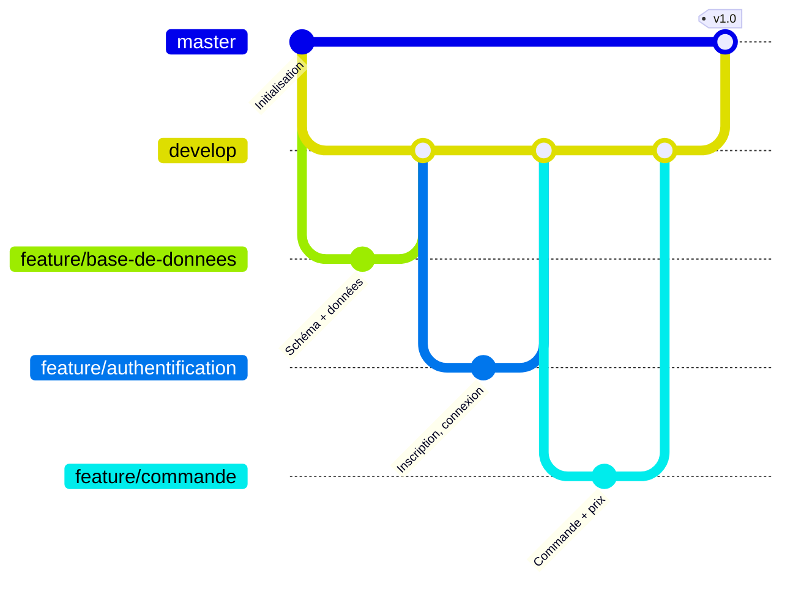

# Vite & Gourmand — Gestion de projet

## 1. Méthode

Le projet suit une approche **agile de type Kanban**, adaptée à un développeur seul encadré par un chef de projet :

- les besoins exprimés par le chef de projet sont découpés en **user stories** ;
- chaque story est une carte du tableau Kanban, et devient une branche Git `feature/...` ;
- un point d'avancement hebdomadaire a lieu avec le chef de projet (démonstration de ce qui est terminé, puis priorisation de la suite) ;
- une story n'est terminée que si elle répond à la **définition de « terminé »** ci-dessous.

**Outil** : Trello (ou Notion), avec un tableau partagé avec le chef de projet. *Lien à ajouter dans le README.*

### Colonnes du tableau

| Backlog | À faire (semaine) | En cours | En test | Terminé |
|---|---|---|---|---|
| Toutes les stories priorisées | Stories retenues pour la semaine | Une seule à la fois | Testée sur la branche `develop` | Fusionnée dans `master` et déployée |

### Définition de « terminé »

1. Le code est sur une branche `feature/...`, fusionnée dans `develop`.
2. Les règles de gestion concernées sont respectées (côté serveur).
3. Les saisies sont validées et l'affichage est échappé (sécurité).
4. La page est utilisable au clavier et sur mobile (RGAA, responsive).
5. Le parcours a été testé manuellement, et les cas d'erreur aussi.

## 2. Priorisation (méthode MoSCoW)

| Priorité | Contenu |
|---|---|
| **Must** (indispensable) | Vue des menus et filtres, détail d'un menu, comptes et connexion, commande avec calcul du prix, espace employé (commandes, statuts), sécurité, déploiement |
| **Should** (important) | Suivi de commande, avis et modération, espace administrateur, statistiques MongoDB, emails |
| **Could** (bonus) | Autocomplétion d'adresse, graphique interactif, galerie d'images |
| **Won't** (hors périmètre) | Paiement en ligne, application mobile native |

## 3. User stories

| # | En tant que... | Je veux... | Afin de... | Priorité |
|---|---|---|---|---|
| US1 | visiteur | voir tous les menus et les filtrer sans recharger la page | trouver rapidement un menu adapté | Must |
| US2 | visiteur | voir le détail d'un menu, ses allergènes et ses conditions | commander en connaissance de cause | Must |
| US3 | visiteur | créer un compte avec un mot de passe sécurisé | pouvoir commander | Must |
| US4 | utilisateur | me connecter et réinitialiser mon mot de passe | accéder à mon espace | Must |
| US5 | utilisateur | commander un menu et voir le détail du prix | savoir ce que je vais payer | Must |
| US6 | utilisateur | modifier ou annuler ma commande avant validation | corriger une erreur | Should |
| US7 | utilisateur | suivre l'état de ma commande | savoir quand je serai livré | Should |
| US8 | utilisateur | donner une note et un avis | partager mon expérience | Should |
| US9 | employé | filtrer les commandes et faire évoluer leur statut | organiser la production | Must |
| US10 | employé | gérer les menus, plats et horaires | tenir le site à jour sans développeur | Must |
| US11 | employé | valider ou refuser les avis | contrôler ce qui est publié | Should |
| US12 | administrateur | créer et désactiver des comptes employés | gérer l'équipe | Should |
| US13 | administrateur | voir les commandes et le CA par menu | piloter l'activité | Should |
| US14 | visiteur | contacter l'entreprise | poser une question ou demander un devis | Must |

## 4. Planning

| Semaine | Étape | Livrables |
|---|---|---|
| 1 | Analyse des besoins, MCD, user stories, tableau Kanban | `01_conception.md`, tableau Trello |
| 1 | Charte graphique, wireframes puis maquettes (3 ordinateur et 3 mobile) | PDF charte et maquettes |
| 2 | Environnement (Docker), scripts SQL, squelette MVC, authentification | US3, US4 |
| 2 | Pages publiques et filtres dynamiques | US1, US2, US14 |
| 3 | Commande, calcul du prix, emails, espace utilisateur | US5 à US8 |
| 3 | Espace employé | US9 à US11 |
| 4 | Espace administrateur, MongoDB, statistiques | US12, US13 |
| 4 | Tests, accessibilité, sécurité, déploiement, documentation | Application en ligne, PDF |

## 5. Organisation Git

- **`master`** : uniquement du code testé, c'est ce qui est déployé.
- **`develop`** : branche d'intégration.
- **`feature/<nom>`** : une branche par user story, créée depuis `develop`, fusionnée dans `develop` (avec `--no-ff`, pour garder la trace de la fonctionnalité) une fois testée.
- Messages de commit clairs et au présent, préfixés par leur type : `feat:`, `fix:`, `docs:`, `refactor:`.

## 6. Gestion des risques

| Risque | Impact | Prévention |
|---|---|---|
| Faille de sécurité (données clients) | Élevé | Requêtes préparées, CSRF, échappement, revue des droits à chaque page |
| Application non en ligne à la livraison (pénalités) | Élevé | Déploiement dès la semaine 2, puis à chaque fusion dans `master` |
| Mauvaise compréhension d'une règle (réduction, livraison) | Moyen | Règles de gestion numérotées et validées avec le chef de projet |
| Indisponibilité de MongoDB | Faible | Les commandes continuent ; les statistiques se reconstruisent depuis MySQL |
