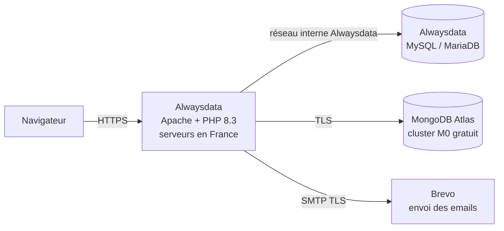

# Vite & Gourmand — Documentation du déploiement

## 1. Architecture de production



| Service | Rôle | Pourquoi ce choix |
|---|---|---|
| **Alwaysdata** (site) | Héberge le code PHP, servi par Apache | Hébergeur français, offre gratuite (100 Mo) avec PHP 8.3, SSH, Git, Composer et HTTPS automatique |
| **Alwaysdata** (base MySQL) | Base relationnelle de l'application | Incluse dans l'offre gratuite, sauvegardes quotidiennes |
| **MongoDB Atlas** | Base des statistiques | Offre gratuite M0, sauvegardes et TLS inclus |
| **Brevo** | Serveur SMTP | Offre gratuite (300 emails par jour), bonne délivrabilité |

> Toute la chaîne fonctionne sur des offres gratuites.

Dans la suite, `<compte>` désigne le nom du compte Alwaysdata.

## 2. Prérequis

1. Un compte [Alwaysdata](https://www.alwaysdata.com) (offre gratuite).
2. Un compte [MongoDB Atlas](https://www.mongodb.com/atlas).
3. Un compte [Brevo](https://www.brevo.com) (facultatif : sans SMTP, les emails sont enregistrés dans `storage/mails/`).

## 3. Base MySQL sur Alwaysdata

Dans l'administration Alwaysdata :

1. *Bases de données → MySQL → Utilisateurs* : créer un utilisateur (par exemple `<compte>_app`) avec un **mot de passe fort**.
2. *Bases de données → MySQL* : créer une base (par exemple `<compte>_vitegourmand`) et donner les droits à cet utilisateur. Le nom est toujours préfixé par le nom du compte.
3. Noter l'hôte : `mysql-<compte>.alwaysdata.net`.

L'import des scripts se fait après la mise en place du code (étape 6).

## 4. MongoDB Atlas

1. Créer un cluster **M0** (gratuit), région Paris ou Francfort.
2. *Database Access* : créer un utilisateur `vite_gourmand` avec le rôle `readWrite` sur la base `vite_gourmand`.
3. *Network Access* : autoriser `0.0.0.0/0`, car les adresses IP sortantes d'Alwaysdata ne sont pas garanties. L'accès reste protégé par l'identifiant, le mot de passe et TLS.
4. *Connect → Drivers* : copier l'URI `mongodb+srv://...`.

## 5. Brevo (SMTP)

1. *SMTP & API → SMTP* : noter le serveur (`smtp-relay.brevo.com`), le port (`587`), l'identifiant et la clé SMTP.
2. Valider l'adresse expéditrice (par exemple `no-reply@...`).

## 6. Mise en place de l'application

### Accès SSH et récupération du code

*Accès distant → SSH* : activer la connexion par mot de passe pour l'utilisateur SSH, puis :

```bash
ssh <compte>@ssh-<compte>.alwaysdata.net
git clone https://github.com/valentinfigueiredo/studi-2026-2027-tp-developpeur-web-et-web-mobile.git ~/www/vite
cd ~/www/vite
composer install --no-dev --optimize-autoloader
```

Vérifier que les extensions nécessaires sont chargées :

```bash
php -v                                     # doit afficher PHP 8.3
php -m | grep -iE 'pdo_mysql|mongodb|intl|curl'
```

Si `php -v` n'affiche pas 8.3, choisir la version dans *Environnement → PHP*. Si l'extension `mongodb` manque, l'activer depuis l'administration (configuration PHP / extensions) avant de continuer.

### Configuration (`.env`)

Le fichier `.env` est créé sur le serveur, dans `~/www/vite` (hors du dossier `public/`, donc jamais accessible depuis le web) :

```bash
cp .env.example .env
nano .env
```

```dotenv
APP_URL=https://<compte>.alwaysdata.net
APP_DEBUG=false

DB_HOST=mysql-<compte>.alwaysdata.net
DB_PORT=3306
DB_NAME=<compte>_vitegourmand
DB_USER=<compte>_app
DB_PASSWORD=<mot-de-passe-fort>

MONGO_URI=mongodb+srv://vite_gourmand:<mdp>@<cluster>.mongodb.net/?retryWrites=true&w=majority
MONGO_DB=vite_gourmand

MAIL_HOST=smtp-relay.brevo.com
MAIL_PORT=587
MAIL_USER=<identifiant-brevo>
MAIL_PASSWORD=<cle-smtp-brevo>
MAIL_FROM=no-reply@<votre-domaine>
MAIL_ENTREPRISE=<email-de-julie-et-jose>
```

```bash
chmod 600 .env
```

### Import des scripts SQL

Toujours en SSH, depuis `~/www/vite` (le script `03_droits.sql` n'est pas utilisé : l'utilisateur a été créé dans l'interface) :

```bash
mysql -h mysql-<compte>.alwaysdata.net -u <compte>_app -p <compte>_vitegourmand < database/01_schema.sql
mysql -h mysql-<compte>.alwaysdata.net -u <compte>_app -p <compte>_vitegourmand < database/02_data.sql
```

Alimenter ensuite MongoDB avec les commandes de démonstration :

```bash
php bin/sync-mongo.php
```

> **Important** : changer ensuite les mots de passe des comptes de démonstration, ou les supprimer, avant une vraie mise en service.

### Configuration du site

*Web → Sites* : modifier le site `<compte>.alwaysdata.net` :

- Type : **PHP**.
- Répertoire racine : **`/www/vite/public`** (seul ce dossier est exposé sur le web).
- Onglet SSL : activer **Forcer HTTPS** (redirection HTTP → HTTPS).

Le fichier `public/.htaccess` envoie toutes les URL vers le contrôleur frontal, et `public/assets/img/menus/uploads/.htaccess` interdit l'exécution de scripts dans le dossier des images envoyées.

## 7. Vérifications après déploiement

- [ ] `https://<compte>.alwaysdata.net` s'affiche, et l'accès en HTTP redirige vers HTTPS.
- [ ] Les menus et les horaires s'affichent (connexion MySQL fonctionnelle).
- [ ] Une inscription envoie bien le mail de bienvenue (SMTP fonctionnel).
- [ ] Le graphique de l'administrateur s'affiche (connexion MongoDB fonctionnelle).
- [ ] `https://<compte>.alwaysdata.net/.env` renvoie une erreur 404 (le fichier est hors de `public/`).
- [ ] L'ajout d'une image de menu fonctionne (droits d'écriture sur le dossier `uploads/`).
- [ ] Journaux sans erreur : `~/admin/logs/` en SSH, ou *Journaux* dans l'administration.

## 8. Mises à jour

Le déploiement se fait toujours depuis la branche `master`, après fusion de `develop` testée :

```bash
ssh <compte>@ssh-<compte>.alwaysdata.net
cd ~/www/vite
git pull
composer install --no-dev --optimize-autoloader
```

En cas de problème, retour à la version précédente :

```bash
git log --oneline             # repérer le commit précédent
git checkout <commit>
```

## 9. Sauvegardes

- **MySQL** : Alwaysdata sauvegarde les bases chaque jour (restauration depuis *Sauvegardes* dans l'administration). Une sauvegarde manuelle est aussi possible en SSH : `mysqldump -h mysql-<compte>.alwaysdata.net -u <compte>_app -p <compte>_vitegourmand > sauvegarde.sql`.
- **MongoDB** : les statistiques peuvent être reconstruites à tout moment depuis MySQL avec `bin/sync-mongo.php`.
