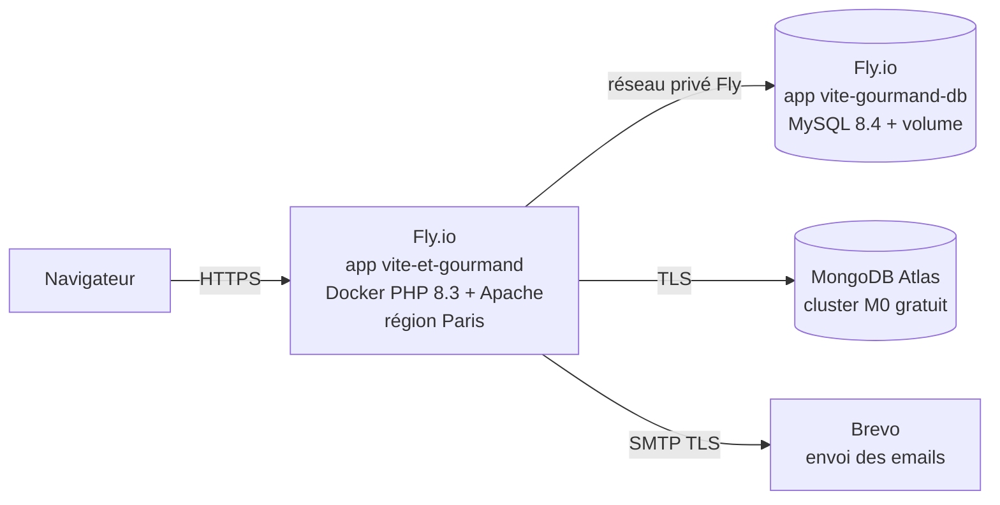

# Vite & Gourmand — Documentation du déploiement

## 1. Architecture de production



| Service | Rôle | Pourquoi ce choix |
|---|---|---|
| **Fly.io** (application) | Héberge le conteneur Docker de l'application | Même image Docker en local et en production, région Paris (`cdg`), HTTPS automatique |
| **Fly.io** (base MySQL) | MySQL dans une seconde application Fly avec un volume persistant | Joignable uniquement par le réseau privé de Fly (chiffré, non exposé sur Internet) |
| **MongoDB Atlas** | Base des statistiques | Offre gratuite M0, sauvegardes et TLS inclus |
| **Brevo** | Serveur SMTP | Offre gratuite (300 emails par jour), bonne délivrabilité |

> Fly.io facture à l'usage : prévoir quelques euros par mois pour deux petites machines et un volume de 1 Go. Les machines de l'application s'arrêtent automatiquement quand il n'y a pas de visite (`auto_stop_machines`).

## 2. Prérequis

1. Un compte [Fly.io](https://fly.io), avec une carte bancaire enregistrée.
2. L'outil en ligne de commande `flyctl` :
   - macOS : `brew install flyctl`
   - Windows : `pwsh -Command "iwr https://fly.io/install.ps1 -useb | iex"`
   - Linux : `curl -L https://fly.io/install.sh | sh`
3. Un client MySQL en local (`mysql`), pour importer les scripts.
4. Un compte [MongoDB Atlas](https://www.mongodb.com/atlas) et un compte [Brevo](https://www.brevo.com).

```bash
fly auth login
```

## 3. Base MySQL sur Fly.io

```bash
mkdir fly-mysql && cd fly-mysql
fly launch --name vite-gourmand-db --image mysql:8.4 --region cdg --no-deploy --no-public-ips
fly volumes create mysqldata --size 1 --region cdg -a vite-gourmand-db
fly secrets set -a vite-gourmand-db MYSQL_ROOT_PASSWORD="<mot-de-passe-root-long>"
```

Remplacer le contenu du `fly.toml` généré par :

```toml
app = "vite-gourmand-db"
primary_region = "cdg"

[build]
  image = "mysql:8.4"

[[mounts]]
  source = "mysqldata"
  destination = "/var/lib/mysql"

[processes]
  app = "--datadir /var/lib/mysql/data"

[[vm]]
  memory = "1gb"
```

```bash
fly deploy -a vite-gourmand-db
```

### Import des scripts SQL

Dans un premier terminal, ouvrir un tunnel sécurisé vers la base :

```bash
fly proxy 3307:3306 -a vite-gourmand-db
```

Dans un second terminal, depuis la racine du projet :

```bash
mysql -h 127.0.0.1 -P 3307 -u root -p < database/01_schema.sql
mysql -h 127.0.0.1 -P 3307 -u root -p < database/02_data.sql
```

Créer l'utilisateur applicatif avec un **mot de passe fort** (ne pas réutiliser celui du fichier `03_droits.sql`, réservé au développement) :

```sql
CREATE USER 'vite_gourmand'@'%' IDENTIFIED BY '<mot-de-passe-applicatif-fort>';
GRANT SELECT, INSERT, UPDATE, DELETE ON vite_gourmand.* TO 'vite_gourmand'@'%';
FLUSH PRIVILEGES;
```

> **Important** : changer ensuite les mots de passe des comptes de démonstration, ou les supprimer, avant une vraie mise en service.

## 4. MongoDB Atlas

1. Créer un cluster **M0** (gratuit), région Paris ou Francfort.
2. *Database Access* : créer un utilisateur `vite_gourmand` avec le rôle `readWrite` sur la base `vite_gourmand`.
3. *Network Access* : autoriser `0.0.0.0/0`, car les adresses IP de Fly.io ne sont pas fixes. L'accès reste protégé par l'identifiant, le mot de passe et TLS.
4. *Connect → Drivers* : copier l'URI `mongodb+srv://...`.

## 5. Brevo (SMTP)

1. *SMTP & API → SMTP* : noter le serveur (`smtp-relay.brevo.com`), le port (`587`), l'identifiant et la clé SMTP.
2. Valider l'adresse expéditrice (par exemple `no-reply@...`).

## 6. Déploiement de l'application

Depuis la racine du projet (le `fly.toml` de l'application est déjà présent) :

```bash
fly launch --copy-config --no-deploy        # crée l'application "vite-et-gourmand"

fly secrets set \
  APP_URL="https://vite-et-gourmand.fly.dev" \
  DB_HOST="vite-gourmand-db.internal" \
  DB_NAME="vite_gourmand" \
  DB_USER="vite_gourmand" \
  DB_PASSWORD="<mot-de-passe-applicatif-fort>" \
  MONGO_URI="mongodb+srv://vite_gourmand:<mdp>@<cluster>.mongodb.net/?retryWrites=true&w=majority" \
  MAIL_HOST="smtp-relay.brevo.com" \
  MAIL_USER="<identifiant-brevo>" \
  MAIL_PASSWORD="<cle-smtp-brevo>" \
  MAIL_FROM="no-reply@<votre-domaine>" \
  MAIL_ENTREPRISE="<email-de-julie-et-jose>"

fly deploy
```

`vite-gourmand-db.internal` est l'adresse de la base sur le réseau privé de Fly : la base n'est jamais exposée sur Internet.

Alimenter ensuite MongoDB avec les commandes de démonstration :

```bash
fly ssh console -C "php /var/www/html/bin/sync-mongo.php"
```

## 7. Vérifications après déploiement

- [ ] `https://vite-et-gourmand.fly.dev` s'affiche, et l'accès en HTTP redirige vers HTTPS.
- [ ] Les menus et les horaires s'affichent (connexion MySQL fonctionnelle).
- [ ] Une inscription envoie bien le mail de bienvenue (SMTP fonctionnel).
- [ ] Le graphique de l'administrateur s'affiche (connexion MongoDB fonctionnelle).
- [ ] `https://vite-et-gourmand.fly.dev/.env` renvoie une erreur 404.
- [ ] Journaux sans erreur : `fly logs`.

## 8. Mises à jour

Le déploiement se fait toujours depuis la branche `master`, après fusion de `develop` testée :

```bash
git checkout master && git pull
fly deploy
```

En cas de problème, retour à la version précédente :

```bash
fly releases                  # liste des versions déployées
fly deploy --image <image-de-la-version-precedente>
```

## 9. Sauvegardes

- **MySQL** : Fly prend des instantanés quotidiens des volumes (`fly volumes snapshots list`). Une sauvegarde logique est aussi possible via le tunnel : `mysqldump -h 127.0.0.1 -P 3307 -u root -p vite_gourmand > sauvegarde.sql`.
- **MongoDB** : les statistiques peuvent être reconstruites à tout moment depuis MySQL avec `bin/sync-mongo.php`.
